<p align="center">
  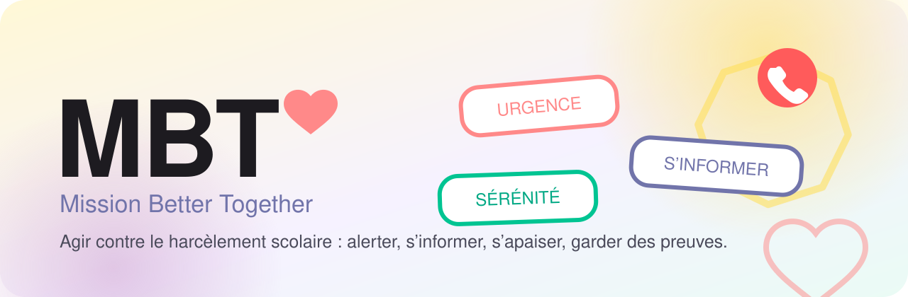
</p>

<p align="center">
  <b>Une application gratuite, privée et sans compte pour agir contre le harcèlement scolaire.</b><br>
  Alerter un proche · Garder des preuves chiffrées · Préparer une conversation · Représenter son ressenti.
</p>

<p align="center">
  <a href="https://github.com/eulogep/mission-better-together/releases/download/v1.0.0-beta.1/MBT-Android-v1.0.0-beta.1.apk"><strong>⬇️ Télécharger MBT pour Android (APK)</strong></a><br>
  Version de test gratuite · Android 7 ou supérieur · <a href="https://github.com/eulogep/mission-better-together/releases/tag/v1.0.0-beta.1">Notes de version et empreinte SHA-256</a>
</p>

<p align="center">
  <a href="https://github.com/eulogep/mission-better-together/actions/workflows/ci.yml"></a>
  <a href="LICENSE"></a>
  
  
  
  
  
  
</p>

<p align="center">
  <a href="#-aperçu">Aperçu</a> ·
  <a href="#-fonctionnalités">Fonctionnalités</a> ·
  <a href="#-vie-privée-par-conception">Vie privée</a> ·
  <a href="#-démarrer-en-2-minutes">Démarrer</a> ·
  <a href="#-architecture">Architecture</a> ·
  <a href="#-feuille-de-route">Feuille de route</a> ·
  <a href="#-contribuer">Contribuer</a>
</p>

---

> **En danger maintenant ?** Appelle le **17** (police) ou le **112**. Si tu ne peux pas parler, envoie un **SMS au 114**.
> Harcèlement ou cyberharcèlement : **3018**, gratuit et anonyme, 7j/7 de 9h à 23h.

## 💛 Pourquoi MBT ?

En France, le harcèlement scolaire est un délit depuis la loi du 2 mars 2022. Pourtant, au moment où ça arrive,
une victime ou un témoin se pose toujours les mêmes questions : *à qui parler ? qui appeler ? comment prouver ?
comment tenir le coup ?*

**MBT répond à ces quatre questions dans une seule application**, pensée pour un ado qui a peur que quelqu’un
regarde son écran :

- 🫥 **Discrète** — sortie rapide en un appui, mode camouflage en fausse page de révisions.
- 🔐 **Privée** — pas de compte ou de traceur. Le carnet reste chiffré sur l’appareil.
- 🧭 **Transparente** — fiches et coordonnées sourcées, récits et mises en situation clairement signalés comme fictifs.
- 📴 **Toujours là** — fonctionne hors ligne, sur mobile comme sur ordinateur, installable sur Android et iOS.

## 📱 Aperçu

<table>
  <tr>
    <td align="center">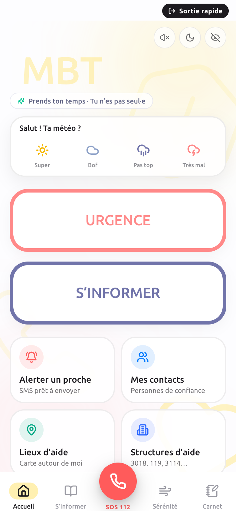<br><sub><b>Accueil</b> — tout en un coup d’œil</sub></td>
    <td align="center">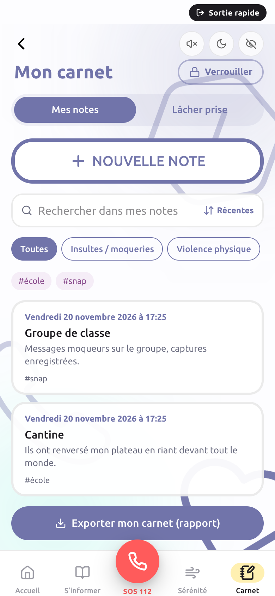<br><sub><b>Carnet</b> — chiffré AES-256 sur l’appareil</sub></td>
    <td align="center">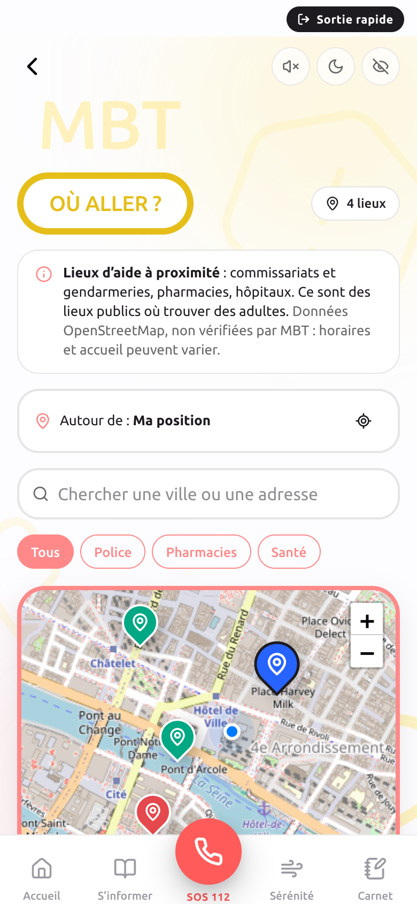<br><sub><b>Lieux d’aide</b> — vraie carte OpenStreetMap</sub></td>
  </tr>
  <tr>
    <td align="center">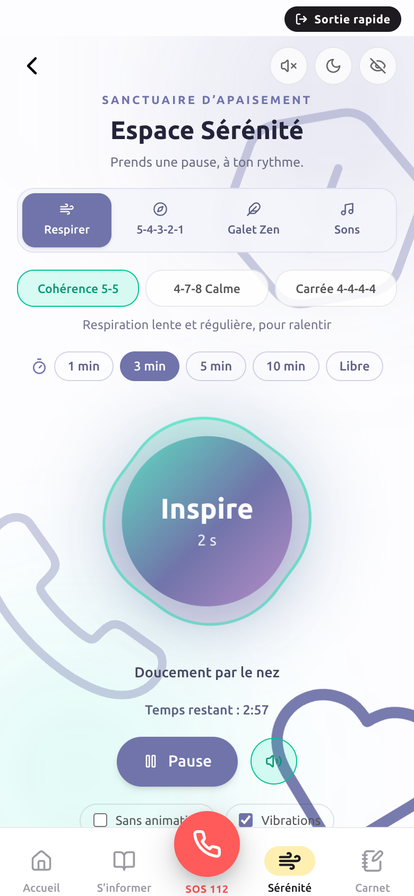<br><sub><b>Sérénité</b> — respiration guidée et sons</sub></td>
    <td align="center">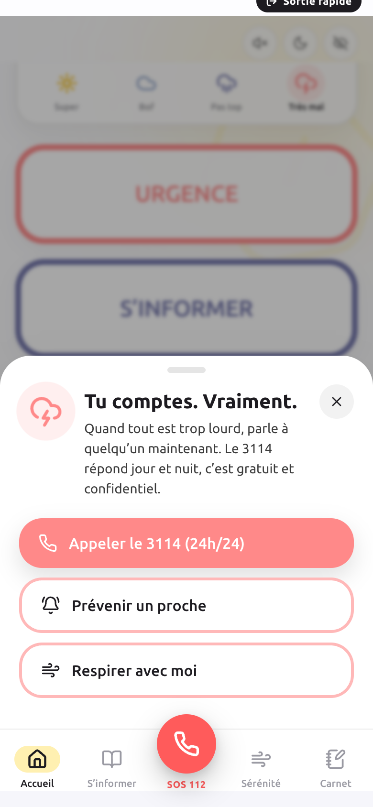<br><sub><b>Météo du jour</b> — une réponse adaptée à ton état</sub></td>
    <td align="center">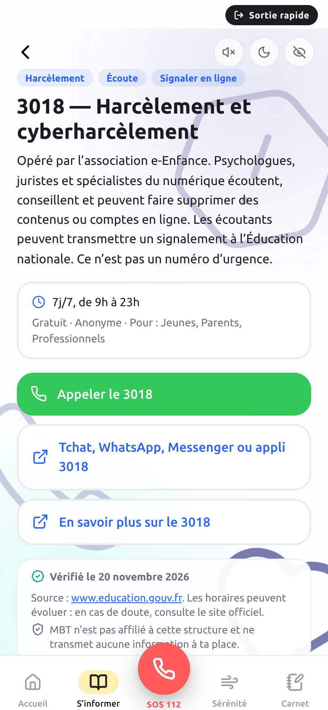<br><sub><b>Structures d’aide</b> — coordonnées vérifiées</sub></td>
  </tr>
  <tr>
    <td align="center">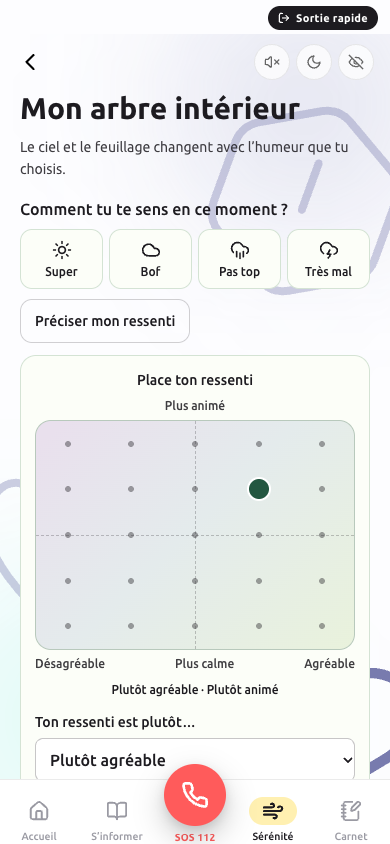<br><sub><b>Mon arbre intérieur</b> — choisir son ressenti sur deux axes</sub></td>
    <td align="center">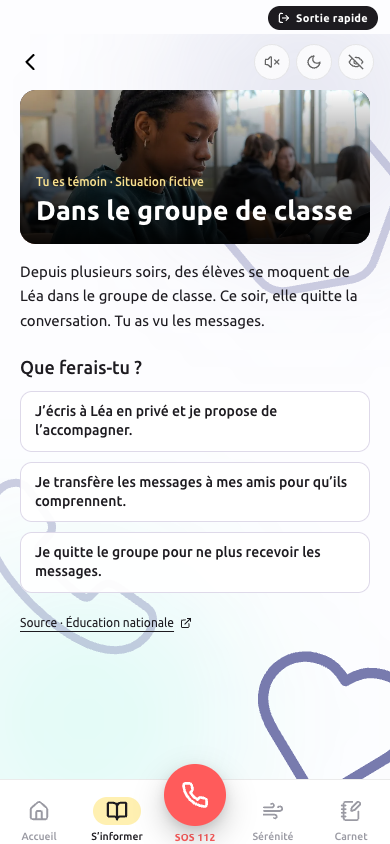<br><sub><b>S’entraîner à réagir</b> — explorer les effets de chaque choix</sub></td>
    <td align="center">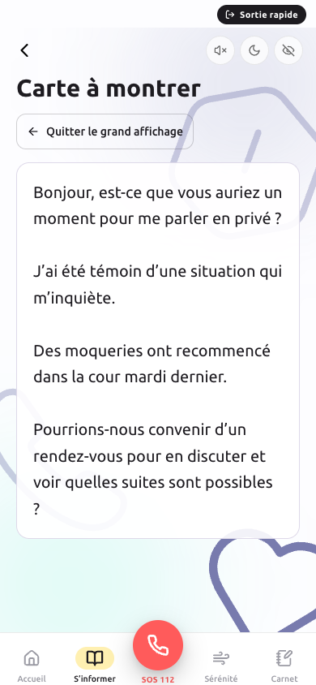<br><sub><b>Préparer une conversation</b> — afficher ses mots pour les montrer</sub></td>
  </tr>
</table>

<p align="center">
  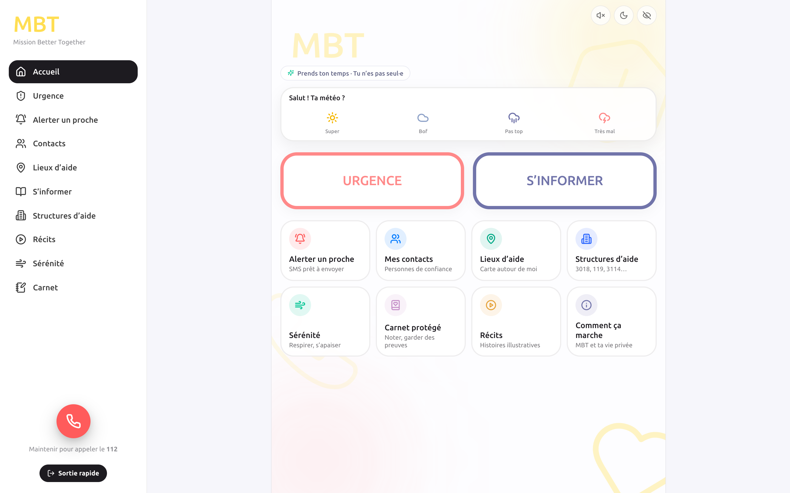<br>
  <sub>La version ordinateur utilise une navigation latérale et une mise en page adaptée à l’écran.</sub>
</p>

## ✨ Fonctionnalités

<table>
<tr>
<td width="50%" valign="top">

### 🚨 Urgence
- **SOS 112** au centre de la navigation : *maintenir appuyé* une seconde (anneau de progression) pour éviter les appels dans la poche.
- Parcours guidé **victime / témoin** (« La victime est-elle blessée ? »…).
- **SMS au 114** pré-rempli quand on ne peut pas parler, position ajoutée sur demande.

</td>
<td width="50%" valign="top">

### 📲 Prévenir un proche
- SMS prêt à envoyer à tes **personnes de confiance**, une ou plusieurs.
- Position GPS ajoutée **uniquement si tu appuies** sur le bouton.
- L’app dit « message préparé », jamais « envoyé » : c’est toi qui envoies.

</td>
</tr>
<tr>
<td valign="top">

### 🔐 Carnet protégé
- Chaque note et chaque capture **chiffrées en AES-GCM 256**, clé dérivée de ton code (PBKDF2, 600 000 itérations).
- Enregistrement automatique, recherche, étiquettes, pièces jointes, **export d’un rapport daté** pour l’école ou une plainte.
- Verrouillage automatique, délai après 5 essais, mode **« Lâcher prise »** (écrire puis tout laisser partir).

</td>
<td valign="top">

### 🌿 Sérénité
- 3 respirations guidées (cohérence 5-5, 4-7-8, carrée) avec **durées** de 1 à 10 min.
- Ancrage **5-4-3-2-1** interactif, galet zen.
- 4 ambiances (pluie, océan, brise, nappe) **générées en direct** par Web Audio : aucun fichier, aucune licence.
- Mode nuit, volume général, option **sans animation**, préférences mémorisées.

</td>
</tr>
<tr>
<td valign="top">

### 🗺️ Lieux d’aide
- Commissariats, pharmacies, hôpitaux autour de toi sur une **vraie carte OpenStreetMap**.
- Recherche par ville, horaires traduits en français, **itinéraire à pied** dans ton appli de cartes.
- Géolocalisation **seulement sur action**, jamais en continu.

</td>
<td valign="top">

### 📚 S’informer
- **8 fiches sourcées et datées** : formes du harcèlement, cyberharcèlement, preuves, la loi, parents, pros…
- **Annuaire de 15 structures réelles** (3018, 119, 3114, Ma Sécurité, 116 006, Pharos…), filtres par type et public.
- Conseils adaptés à l’âge : primaire, collège/lycée, adulte, parent.

</td>
</tr>
<tr>
<td valign="top">

### 🎧 Récits
- Huit récits fictifs, à filtrer par contexte (école, en ligne, famille ou stage).
- Transcriptions en français et en anglais, huit narrations de synthèse françaises intégrées et sous-titres synchronisés, y compris hors ligne.
- Illustrations générées par IA et fiche pratique liée à chaque récit.

</td>
<td valign="top">

### 🤝 S’entraîner à réagir
- Trois mises en situation fictives pour se placer du point de vue d’un témoin, d’un élève ou d’un parent.
- Chaque réponse explique ce qu’elle peut changer et donne accès à une fiche pratique et à des sources officielles.
- Un modèle de phrase modifiable aide à préparer les premiers mots.

</td>
</tr>
<tr>
<td valign="top">

### ✍️ Préparer une conversation
- Choisis ta situation, ton interlocuteur et l’aide que tu aimerais demander pour composer un brouillon modifiable.
- Répète le texte paragraphe par paragraphe, copie-le ou affiche-le en grands caractères pour le montrer à quelqu’un.
- Le brouillon s’efface quand tu quittes l’écran ou passes en mode discret.

</td>
<td valign="top">

### 🌳 Mon arbre intérieur
- Un arbre illustré réagit au ressenti choisi depuis l’accueil ou le jardin.
- La grille de 25 points combine deux dimensions du ressenti, de désagréable à agréable et de calme à animé. Les deux listes permettent aussi d’exprimer un ressenti mélangé.
- La météo et le mouvement de l’arbre donnent une représentation visuelle du moment. Le modèle, les sources scientifiques et leurs limites sont détaillés dans la [note de recherche](docs/RECHERCHE-EMOTIONS.md).

</td>
</tr>
</table>

Et aussi, les contacts d’urgence (ajout, modification, import Android), l’assistant d’orientation, l’accueil du premier lancement en trois étapes et les raccourcis d’icône (« Alerter », « Lieux », « Carnet »).

## 🔒 Vie privée par conception

| | |
|---|---|
| **Aucun compte, aucun serveur MBT** | Il n’existe pas de base de données où tes informations pourraient fuiter. |
| **Carnet chiffré** | Sans ton code, personne ne peut le lire, pas même les développeurs. Un test automatique vérifie qu’aucun texte n’est stocké en clair. |
| **Ressenti et brouillons** | Le ressenti reste dans l’onglet et peut être effacé à tout moment. Les brouillons de conversation vivent le temps de l’écran. Le mode discret efface les deux. |
| **Zéro traceur** | Pas d’analyse d’audience, pas de publicité, police auto-hébergée (aucune requête vers Google). |
| **Rien d’automatique** | Aucun appel, SMS ou partage de position sans ton geste. |
| **Discrétion** | Sortie rapide, mode camouflage, verrouillage auto, aperçu masqué dans les applis récentes (Android). |
| **CSP stricte** | En production, seuls les services réellement utilisés (OpenStreetMap, IGN) sont autorisés. |

Détails, limites et obligations RGPD / mineurs : [docs/SECURITE.md](docs/SECURITE.md).

## 🚀 Démarrer en 2 minutes

### Installer sur Android

[Télécharger l’APK de test](https://github.com/eulogep/mission-better-together/releases/download/v1.0.0-beta.1/MBT-Android-v1.0.0-beta.1.apk), puis ouvrir le fichier sur le téléphone. Android peut demander d’autoriser l’installation depuis le navigateur. Les essais des appels, des SMS, de la localisation et de la biométrie sur téléphones restent à effectuer. Utilise des données fictives pour ces essais.

La CI utilise **Node.js 22**. Google Chrome est requis pour les tests de parcours.

```bash
git clone https://github.com/eulogep/mission-better-together.git
cd mission-better-together
npm ci
npm run dev            # → http://localhost:5173
```

| Commande | Rôle |
| --- | --- |
| `npm run check` | Types + tests unitaires + build de production |
| `npm run test:e2e` | Lance les tests Playwright sur les profils mobile et ordinateur |
| `npm run build` puis `npm run preview` | Lance la prévisualisation locale du build de production, avec CSP et service worker |
| `npm run mobile:sync` | Build + copie dans les projets Android et iOS |
| `npm run mobile:android` / `mobile:ios` | Ouvre Android Studio / Xcode |

> Pour le déploiement web, héberge `dist/` en **HTTPS** et redirige les routes de l’application vers `/index.html`.
> Les liens directs incluent `/jardin`, `/entrainement`, `/preparer-conversation`, `/carnet` et `/lieux`.

## 🧱 Architecture

**React 19 · TypeScript strict · Vite 6 · Tailwind CSS 4 · framer-motion · Leaflet · Capacitor 8**

Une seule base de code pour le web, Android et iOS. Le choix (web + Capacitor plutôt que React Native) est
justifié dans [docs/ARCHITECTURE.md](docs/ARCHITECTURE.md).

```
src/
├── app/          routes (URL ↔ écran), navigation par historique, mise en page responsive
├── features/     carnet, bibliothèque, annuaire, atelier, conversation, arbre intérieur
├── lib/          coffre, appareil, lieux, contacts, préférences et représentation du ressenti
├── screens/      écrans de l’application
└── data/         contenus versionnés : numéros, fiches sourcées, structures vérifiées
tests/
├── unit/         Vitest (chiffrement, migration, routes, contenus, modèle du ressenti)
└── e2e/          Playwright (mobile 390×844 et ordinateur 1440×900)
android/ ios/     projets natifs Capacitor
docs/             audit, architecture, sécurité, mobile et recherche sur les émotions
```

### Qualité

| Vérification | Résultat |
| --- | --- |
| TypeScript strict | ✅ |
| Tests unitaires (Vitest) | ✅ 70/70 |
| Parcours (Playwright, build de production) | ✅ 76 cas validés sur les profils mobile et ordinateur, dont un relancé séparément |
| Compilation Android | ✅ APK de test et AAB non signé. [État des essais mobiles](docs/MOBILE.md#état-vérifié-le-20-novembre-2026) |
| Backend de modération | ✅ [Scénario SQL sur PostgreSQL embarqué](docs/MODERATION.md#vérification-et-mise-en-service) |
| Défilement horizontal à 320 px | ✅ aucun |

La [CI du commit `f011e22`](https://github.com/eulogep/mission-better-together/actions/runs/44789575336) a validé les types, les tests unitaires, le build et les parcours Chrome. Les tests couvrent notamment le carnet chiffré, les liens directs, le mode discret, le fonctionnement hors ligne et la sélection du ressenti au clavier et au pointeur.

## 🗺️ Feuille de route

- [x] Application web responsive, installable et hors ligne
- [x] Carnet chiffré, alerte SMS, lieux d’aide, sérénité, bibliothèque, annuaire
- [x] Récits filtrables, atelier interactif et préparation de conversation
- [x] Arbre intérieur et grille de représentation du ressenti
- [x] Projets Android et iOS (Capacitor), APK Android compilé
- [ ] [Essais sur appareils réels](docs/MOBILE.md#protocole-sur-appareils-réels) (appels, SMS et permissions)
- [ ] Biométrie du carnet intégrée côté Android et iOS. Validation sur téléphones et compilation iOS en attente.
- [ ] Avis de professionnels de l’enfance. [Dossier de relecture](docs/RELECTURE-ENFANCE.md)
- [x] [Huit narrations de synthèse françaises préenregistrées](docs/VOIX.md), utilisables hors ligne
- [ ] [Backend modéré des témoignages](docs/MODERATION.md). Migration testée localement. Déploiement et collecte en attente.
- [ ] Publication sur Google Play et l’App Store. [Préparation et dépendances](docs/MOBILE.md#préparation-de-publication)

## 🤝 Contribuer

Les contributions sont les bienvenues, qu’elles soient du code, des contenus ou de l’accessibilité.
Lis [CONTRIBUTING.md](CONTRIBUTING.md) avant de commencer. Deux règles d’or :

1. **Rien de simulé** : une fonctionnalité fait ce qu’elle annonce, ou dit clairement qu’elle n’est pas disponible.
2. **La sécurité des utilisateurs passe avant tout** : pas de collecte, pas d’action automatique, sources officielles pour tout numéro ou conseil.

Une idée, un bug, un numéro qui a changé ? Ouvre une [issue](https://github.com/eulogep/mission-better-together/issues).

## ☎️ Numéros utiles (France — vérifiés le 20/11/2026)

| Situation | Numéro |
| --- | --- |
| Danger immédiat | **17** police · **15** SAMU · **112** urgence européenne · **114** par SMS |
| Harcèlement, cyberharcèlement | **3018** — 7j/7, 9h–23h, aussi par tchat, WhatsApp, Messenger |
| Enfant en danger | **119** — 24h/24 |
| Idées suicidaires | **3114** — 24h/24 |
| Victime d’une infraction | **116 006** — 7j/7, 9h–20h |
| Jeunes 12–25 ans | **0 800 235 236** — Fil Santé Jeunes |
| Violences sexistes et sexuelles | **3919** — 24h/24 |

MBT n’est affilié à aucun de ces services et ne remplace ni les secours ni un accompagnement professionnel.

## 📄 Licence

Code sous licence [MIT](LICENSE) — © 2026 Eulogep.

Composants tiers sous leur propre licence : police Ubuntu (Ubuntu Font Licence 1.0), Leaflet (BSD-2-Clause),
React, Vite, Tailwind CSS, framer-motion, lucide-react, Capacitor (MIT). Données cartographiques
© contributeurs OpenStreetMap (ODbL). Narrations françaises sous [CC BY-SA 4.0](public/audio/ATTRIBUTIONS.md).

---

<p align="center">
  <b>Si MBT peut aider quelqu’un autour de toi, laisse une ⭐ et partage le projet.</b><br>
  <sub>Chaque étoile rend l’application plus visible pour les écoles, les associations et les familles.</sub>
</p>
